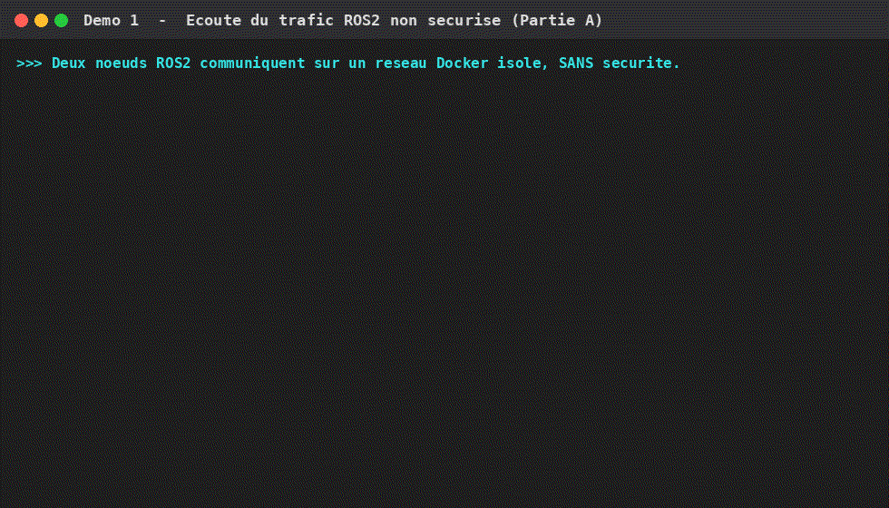
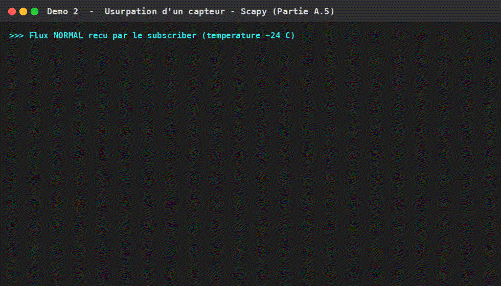
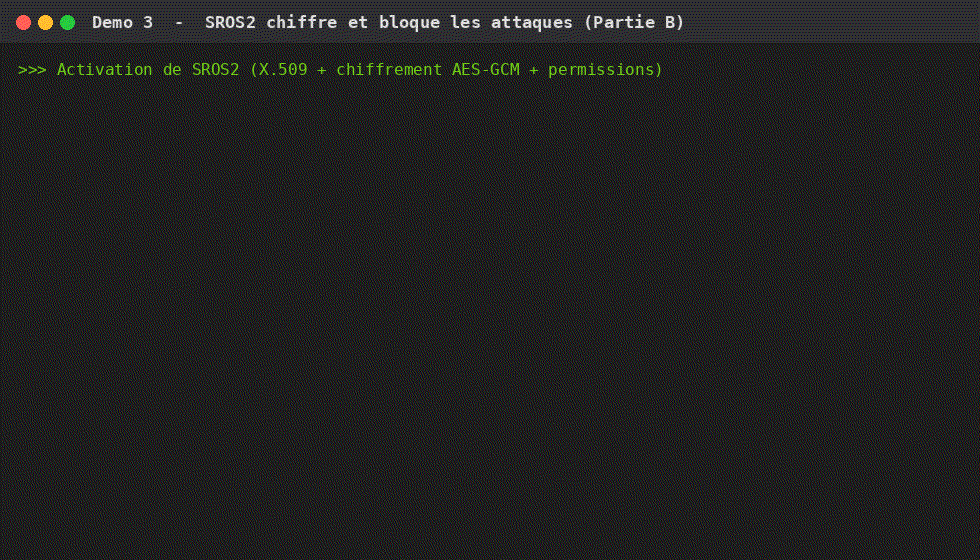

# TP Cybersécurité S7: Sniffing & sécurisation d'un réseau robotique ROS2

**Corrigé complet** du TP *« Network Lab : Sniffing and Analysing a ROS2 Robot
Network From Unsecured DDS to SROS2 Encryption »* (HESTIM, 4ᵉ année
Cybersecurity).

Tout l'environnement tourne dans **Docker** (ROS2 **Humble**), sous **Windows 11**.
Tous les résultats du rapport ont été reproduits sur le réseau Docker **isolé**
`ros2_lab`.

> ⚠️ **Cadre.** Matériel strictement pédagogique, à utiliser **uniquement** sur le
> réseau Docker isolé du TP et sur vos propres conteneurs. Ne jamais sniffer ni
> injecter sur un réseau de production.

---

## Structure du dépôt

```
tp-cybRobot/
├── README.md                    ← ce fichier
├── rapport/
│   ├── rapport.tex              ← rapport de correction (LaTeX)
│   └── rapport.pdf              ← rapport compilé (8 pages)
├── ros2_lab/
│   ├── Dockerfile               ← image ros2-lab:humble (ROS2 + SROS2 + Scapy + tcpdump)
│   ├── docker-compose.yml       ← publisher + subscriber + attacker
│   ├── capture.ps1              ← capture le trafic du bridge Docker → .pcap
│   ├── lab_nodes/               ← publisher.py, subscriber.py
│   ├── captures/                ← unsecured / discovery / secured / navigating / idle .pcap
│   ├── sros2/                   ← governance.xml, tp_policy.xml, permissions_*.xml
│   └── keystore/                ← keystore SROS2 (certificats X.509) — LABO uniquement
├── scripts/
│   ├── inject_dds.py            ← injection/spoofing DDS (Scapy)        Partie A.5 / B.4
│   ├── timing_analysis.py       ← fingerprinting temporel → timing_plot ← Partie B.5
│   └── gen_figures.py           ← génère les figures « données » du rapport
├── figures/                     ← figures générées + captures d'écran annotées
└── videos/                      ← vidéos de démo (.gif/.mp4) + scripts OBS + guide
```

## Prérequis
- **Docker Desktop** (le moteur doit tourner)
- **Wireshark** (analyse des `.pcap`)
- **MiKTeX** (seulement pour recompiler le rapport)
- Accès à Docker Hub bloqué ? l'image de base a été tirée via le miroir
  `mirror.gcr.io/library/ros:humble-ros-base` puis retaguée `ros:humble-ros-base`.

## Démarrage rapide
```powershell
cd ros2_lab
docker network create --driver bridge ros2_lab   # ignorer si « already exists »
docker compose up -d
docker ps
docker exec -it ros2_attacker bash               # puis : ros2 topic list
```

### Partie A : sniffing non sécurisé
```powershell
.\capture.ps1 -Name unsecured -Seconds 60        # → captures\unsecured.pcap
.\capture.ps1 -Name discovery -Seconds 30 -Restart   # capture la découverte (topics/types)
```
Dans Wireshark, ouvrir le **fichier** `.pcap` (ne pas capturer en direct sur
Wi-Fi). Filtres utiles : `rtps`, `rtps.param.topicName`, `rtps.sm.id == 0x15`.

Injection (spoofing) :
```powershell
$BR = "br-" + (docker network inspect -f '{{.Id}}' ros2_lab).Substring(0,12)
docker run --rm --net=host --cap-add NET_ADMIN --cap-add NET_RAW -v "${PWD}\..\scripts:/s" `
  ros2-lab:humble python3 -I /s/inject_dds.py --iface $BR --count 8
```

### Partie B : SROS2
```powershell
docker exec -it ros2_attacker bash
  cd /lab/work
  ros2 security create_keystore keystore
  ros2 security create_enclave keystore /publisher_node
  ros2 security create_enclave keystore /subscriber_node
  ros2 security create_permission keystore /publisher_node  sros2/tp_policy.xml
  ros2 security create_permission keystore /subscriber_node sros2/tp_policy.xml
  exit
$env:ROS_SECURITY_ENABLE = "true"; $env:PUBLISH_COMMANDS = "false"; $env:SUBSCRIBE_COMMANDS = "false"
docker compose up -d --force-recreate publisher subscriber
.\capture.ps1 -Name secured -Seconds 60          # → charge chiffrée
```
Retour en mode non sécurisé : `Remove-Item Env:ROS_SECURITY_ENABLE; docker compose up -d --force-recreate publisher subscriber`

## ⚠️ Trois corrections apportées à l'énoncé (spécifiques à ROS2 Humble)
1. **Capture** : sous Windows, Wireshark ne voit pas le réseau Docker. Capturer
   sur l'interface **bridge** `br-xxxx` (via `capture.ps1`), pas sur Wi-Fi.
2. **Filtre** : `udp.port == 7400` ne montre que la découverte ; les données sont
   sur 7410/7411. Utiliser le filtre **`rtps`**.
3. **SROS2** : nom d'enclave avec `/` initial ; variables **`ROS_SECURITY_ENABLE`**
   (sans « D ») et **`ROS_SECURITY_KEYSTORE`** (pas `_PATH`).

## 🎥 Démonstrations (vidéos)

### 1. Écoute du trafic non sécurisé (Partie A)
Topics visibles sans authentification et mesures lues en clair.



### 2. Usurpation d'un capteur avec Scapy (Partie A.5)
Le `subscriber` bascule de `24 °C` à la fausse valeur injectée `99.9`.



### 3. SROS2 chiffre et bloque les attaques (Partie B)
Trafic chiffré (0 texte lisible), injection rejetée, écoute impossible.



> Versions MP4 : [`demo1_sniffing.mp4`](videos/demo1_sniffing.mp4) ·
> [`demo2_injection.mp4`](videos/demo2_injection.mp4) ·
> [`demo3_sros2.mp4`](videos/demo3_sros2.mp4). Pour enregistrer une démo live
> (vraie fenêtre Wireshark) avec OBS, voir [`videos/README.md`](videos/README.md).

## Recompiler le rapport
```powershell
cd rapport
latexmk -pdf rapport.tex
```
